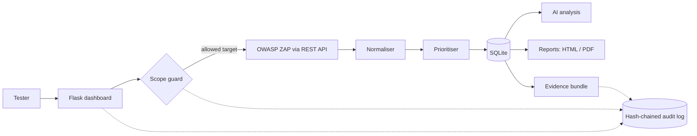

# AEGIS AI


**An AI-assisted web security assessment platform for authorized testing.** AEGIS AI drives OWASP ZAP against a
scope-restricted target, normalises and prioritises the findings, explains them in plain language, and produces
professional reports and tamper-evident forensic evidence bundles.

| Dashboard | 3D attack surface |
| --- | --- |
|  |  |

| PDF report | Evidence verification |
| --- | --- |
|  |  |

## Why this project

Manually organising scanner output is slow, and most "AI security tools" ask you to trust a model's claims. AEGIS AI is built
around the opposite idea: **scanner output stays the source of truth, AI is advisory and checked, and everything that happens
is auditable.** It is also built with a DFIR mindset, so assessments leave behind evidence that can be verified later.

## Features

- **Scope-restricted scanning.** Only targets in an allow-list can be scanned. Passive and active ZAP scans, one scan at a time, with a time limit.
- **Normalised findings in SQLite**, each with a SHA-256 evidence hash taken when it is stored.
- **Rule-based risk prioritisation** (0-100) from severity, exposure, CIA impact and fix availability. Low-confidence findings are labelled *Requires verification*, never presented as confirmed.
- **Dashboard** with findings summary, trends across assessments, top components and finding types.
- **3D attack-surface map** of the target, its components and finding types.
- **AI analysis.** Plain-language explanation, possible impact and remediation, with related findings grouped and ranked.
  A built-in knowledge base always works; an optional local model (Ollama) can rewrite the text, and its answers are rejected if they mention CVE, CWE or URL values that are not in the scan data.
- **Reports** as HTML and PDF: executive summary, scope and method, grouped findings, remediation, retest comparison with the previous assessment, limitations.
- **Forensic evidence bundles.** A ZIP with findings, timeline, the audit-log hash chain, a file manifest, a chain-of-custody record and a standalone verifier. Bundles can be re-verified later on the Evidence page.
- **Hash-chained audit log** of every scan, rejection, export and settings change.

## Architecture



## Quick start

Requirements: Docker Desktop, Python 3.10 or newer, Git.

```bash
git clone https://github.com/yooooo-bit/aegis-ai.git
cd aegis-ai

# 1. Start the practice lab: OWASP Juice Shop (:3000) and the ZAP API (:8080), both bound to localhost
docker compose up -d

# 2. Install and run AEGIS AI
python -m venv .venv
# Windows:      .venv\Scripts\activate
# Linux/macOS:  source .venv/bin/activate
pip install -r requirements.txt
python run.py
```

Open http://127.0.0.1:5000, go to **Assessments**, keep **Passive** selected, tick the authorization box and start an assessment.
A passive scan of Juice Shop usually takes a few minutes. Change the ZAP key by setting `ZAP_API_KEY` (see `.env.example`) before `docker compose up`, and match it under **Settings**.

## Design decisions

**Safety first.** The allow-list lives in `config.py` and is deliberately not editable from the web UI. The web app binds to `127.0.0.1`,
ZAP and Ollama addresses must be local, and every rejected scan is logged.

**Honest findings.** Results are labelled as scanner output. Scores are rule-based triage estimates, not a formal risk rating.

| Score part | Points |
| --- | --- |
| Scanner severity | High 50, Medium 30, Low 12, Informational 3 |
| Exposure | 5 for a local lab, 15 if marked internet-facing |
| CIA impact | Looked up by CWE (for example SQL injection 25, XSS 15, missing headers 8) |
| Fix available | 10 |

Labels: 70+ Critical, 50+ High, 30+ Medium, otherwise Low. Low-confidence findings become *Requires verification*.

**AI that cannot invent findings.** The AI layer never creates, removes or changes a finding. The local model sees only the stored fields of a finding group,
must return JSON, and is rejected if it cites identifiers or URLs that are not in the scan data. The page always says which source wrote each explanation.

**Evidence you can check later.** Every file in a bundle is hashed in `manifest.json`, every finding is re-hashed on verification, and the manifest hash is written into
the app's own hash-chained audit log at export time. An offline script (`verify_bundle.py`) is included in every bundle. Rewriting a whole bundle consistently is caught by
the audit-log anchor on the Evidence page.

## Testing

```bash
python -m unittest discover -s tests -v
```

The suite (17 tests, standard library only) covers the scope guard, prioritisation, audit-chain tamper detection, evidence export and verification
(including a fully rewritten bundle and unsafe input), AI grounding checks, and the scan pipeline against a fake ZAP API. It runs on every push through GitHub Actions.

## Project structure

```
config.py              settings defaults and the target allow-list
run.py                 entry point (binds to localhost)
docker-compose.yml     Juice Shop + ZAP lab
app/
  scope.py             scope guard
  scanner.py           ZAP REST client and normalisation
  prioritizer.py       rule-based scoring
  pipeline.py          scan -> score -> store -> explain
  db.py                SQLite, evidence hashes, hash-chained audit log
  ai.py, knowledge.py  analysis: rules + optional local model with grounding checks
  reports.py           HTML/PDF report data and PDF rendering
  evidence.py          evidence bundle export and verification
  dash.py, graph.py    dashboard charts and 3D graph data
  settings.py          runtime settings
  routes.py            Flask routes
templates/             pages
tests/                 unit and integration tests
```

## Limitations and roadmap

- Built and tested against local lab targets (Juice Shop); the allow-list must be edited to add others.
- Unauthenticated scanning only. Login-aware scans are not supported yet.
- Priority weights are heuristics and have not been validated against a labelled dataset.
- Planned: an accuracy evaluation against Juice Shop's documented vulnerabilities (detection rate and false positives), OWASP Top 10 mapping, scheduled retests.
- The dashboard has no user login because it is meant to run on a single local machine.

## Responsible use

Only scan systems you own or have written permission to test. Active scans send attack-style requests. The defaults restrict AEGIS AI to a local practice target on purpose.

## AI-assisted development

Parts of this codebase were written with the help of an AI assistant (Claude by Anthropic). <!-- Edit to describe your own contribution: design decisions, integration, testing, reviewing every change. -->

## License

MIT. See [LICENSE](LICENSE).
